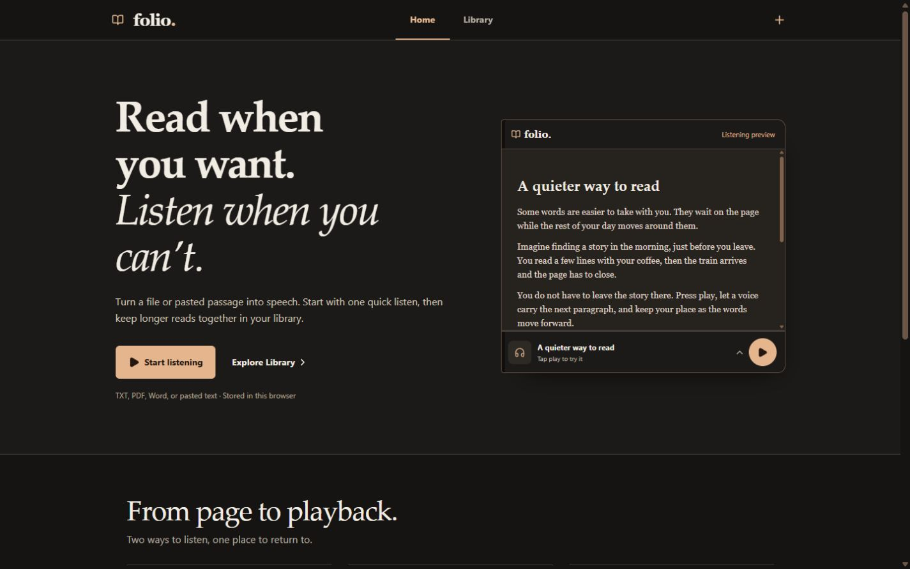
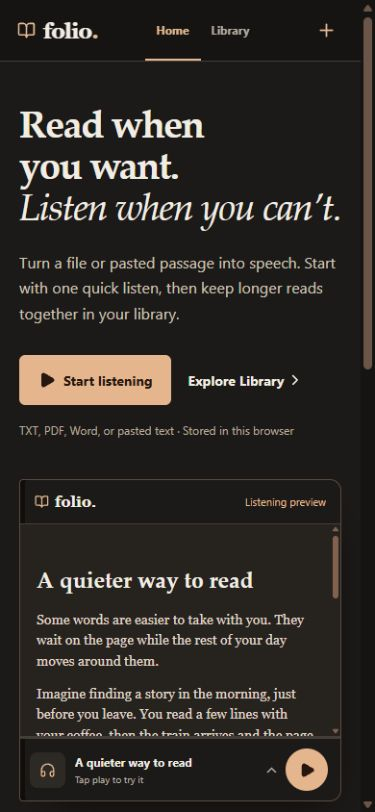
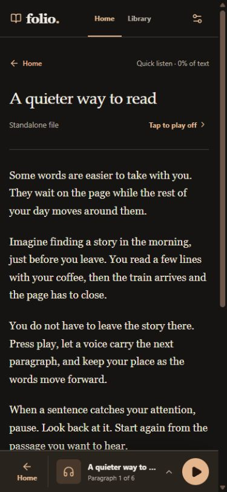
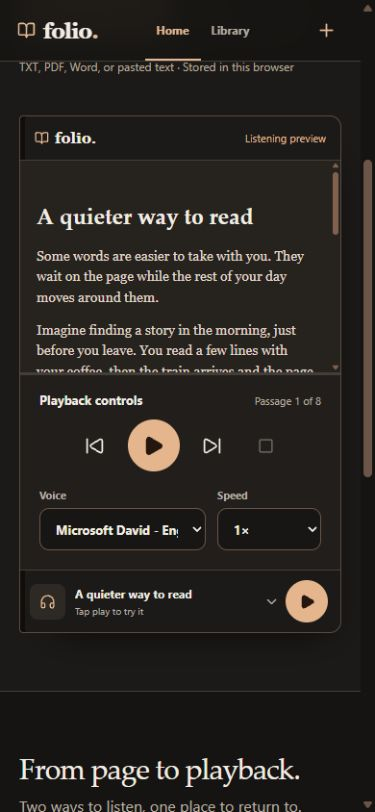

# Folio

### Read when you want. Listen when you can’t.

Folio is a mobile-first reader that turns your own documents and pasted passages into a calmer reading and listening experience. Try the speech preview on the landing page, start a standalone **Quick Listen**, or keep a longer work organized in your **Library**.

**[Open the live app](https://reader-tts-app.vercel.app/)** · **[View the source](https://github.com/iSungha/reader-tts-app)**

## Screenshots



| Mobile home | Reader with sample text | Expanded sample player |
| :---: | :---: | :---: |
|  |  |  |

## The experience

| | |
| --- | --- |
| **Try it immediately** | The landing page includes a preloaded text-to-speech preview with playback controls. |
| **Bring your own reading** | Add TXT, PDF, or DOCX files, or paste text. Quick Listens stay separate from books. |
| **Keep chapters together** | Create book folders, add related files, and move files between folders while keeping their progress. |
| **Pick up where you left off** | Folio saves reading and listening positions. File progress follows the furthest readable text covered; folder progress is weighted by each file’s readable text length. |
| **Make listening yours** | Choose an available browser voice and playback speed, including 1.2×. Skip paragraphs, pause, resume, or stop from the expandable player. |
| **Settle in to read** | Adjust text size, line spacing, paragraph spacing, alignment, and reading width. “Tap to play” is off by default so touching the page does not unexpectedly move playback. |

The interface is designed around a phone-sized screen, with a compact player that keeps the current read close at hand. Home and Library remain in the header, while reader back actions and playback controls are reachable near the bottom on mobile.

## Run locally

You’ll need a current Node.js version and npm.

```bash
git clone https://github.com/iSungha/reader-tts-app.git
cd reader-tts-app
npm install
npm run dev
```

Open the local address printed by Vite. To check the production build and lint rules:

```bash
npm run build
npm run lint
```

## How it works

Folio is a frontend-only React, TypeScript, and Vite app. It extracts supported documents in the browser and stores the original files, extracted text, folders, and progress in IndexedDB. Identical file content is recognized by a SHA-256 hash. Reading preferences are stored in the browser. Speech is generated by the browser’s Web Speech API; no account or server-side library is required.

Your library is tied to the browser profile and device where you added it. Clearing site data can remove it. Folio requests persistent browser storage where supported, but the browser decides whether to grant it. Voice choices and quality vary by browser and operating system; playback may need a tap after reopening a file, and background or lock-screen playback is not guaranteed.

## Built with

React 19 · TypeScript · Vite · Web Speech API · IndexedDB · PDF.js · Mammoth
